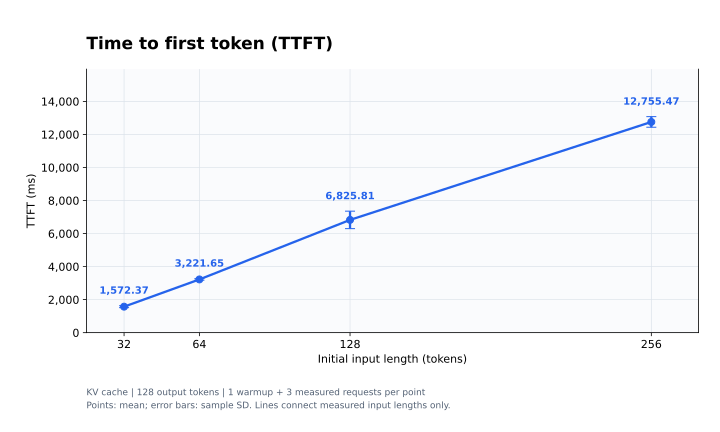
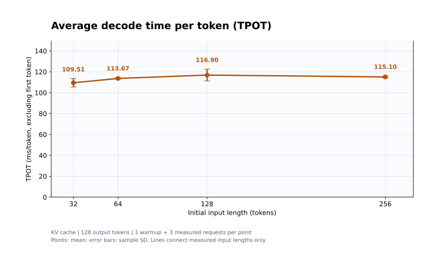
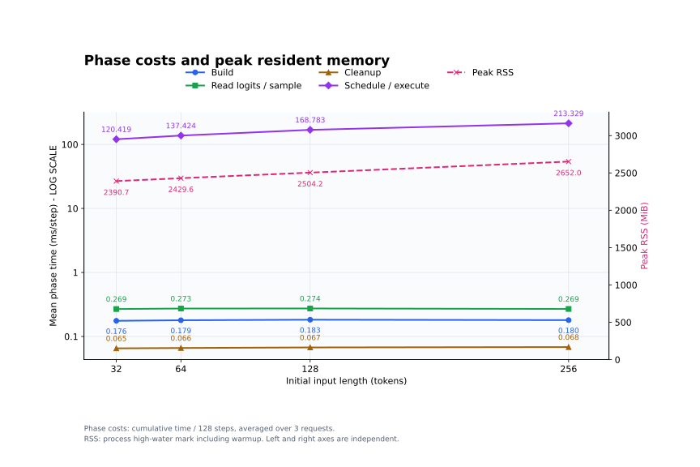

# Infer-LLM

仿照 llama.cpp 开发一个 C++ 推理框架，学习大模型如何进行推理。

| 日期 | 性能测试 | 报告与原始数据 |
|---|---|---|
| 2026-11-04 | CPU：连续 KV Cache（最新） | [查看报告](docs/performance/cpu-contiguous-kv-20261104/README.md) · [数据目录](docs/performance/cpu-contiguous-kv-20261104/) |
| 2026-10-28 | CPU：无 KV Cache | [查看报告](docs/performance/cpu-no-kv-20261028/README.md) · [数据目录](docs/performance/cpu-no-kv-20261028/) |

## 测试环境与版本

| 项目 | 配置 |
|---|---|
| 无 KV 基线版本 | `6c6df88dd556898e8deea78211ec94a639dec328` |
| 连续 KV 测试版本 | `78087a6d38871f67e549deda48b707a68670c60f` + 测试时的工作区改动；见[源码指纹](docs/performance/cpu-contiguous-kv-20261104/source-hashes.json) |
| CPU | 13th Gen Intel Core i7-13620H |
| 系统 | WSL2，Ubuntu 20.04.3 LTS，x86_64 |
| 内核 | `6.18.54.1-microsoft-standard-WSL2` |
| 可见资源 | 16 个逻辑 CPU；约 7.64 GiB RAM；2 GiB Swap |
| 工作线程 | 8 个线程池 worker（无 KV 基线自动选择，连续 KV 测试显式指定）；主线程也参与计算；未绑核、未固定 CPU 频率 |
| 构建 | Release，GCC 13.1.0，`-O3 -DNDEBUG`；CPU-only |
| 模型 | `models/Qwen3-0.6B-F32.gguf`，F32，2,390,150,816 字节 |
| 输入 / 采样 | 固定合成 token `(100+i) % vocab_size`；贪心采样；遇 EOS 仍生成至指定数量 |
| 负载 | 单请求、各组独立进程、串行执行 |
| 计时工具 | 独立 C++ `inferllm-bench`，`std::chrono::steady_clock` |

## 最新测试：CPU 连续 KV Cache

初始输入 **32、64、128、256 token**，每组固定生成 **128 token**。首轮 Prefill，后续 127 步为单 token Decode。
每组预热 1 次、正式测量 3 次；曲线点为均值，误差棒为样本标准差。历史测试通过上表查看。

### TTFT：首 token 延迟

输入增长 8 倍时，TTFT 从 **1.572 s** 增至 **12.755 s**，总体接近线性增长。不包含模型加载和分词。

### TPOT：后续 token 平均耗时

排除首 token，四组 TPOT 约 **110–117 ms/token**。128 与 256 两点的误差范围重叠，不能认定更长上下文更快。

| 输入 token | TTFT (ms，均值 ± 标准差) | TPOT (ms/token，均值 ± 标准差) | Decode (token/s) | 请求总耗时 (s) |
|---:|---:|---:|---:|---:|
| 32 | 1572.37 ± 59.90 | 109.51 ± 4.06 | 9.140 | 15.480 |
| 64 | 3221.65 ± 49.05 | 113.67 ± 0.77 | 8.798 | 17.657 |
| 128 | 6825.81 ± 527.85 | 116.90 ± 5.70 | 8.568 | 21.672 |
| 256 | 12755.47 ± 320.92 | 115.10 ± 0.92 | 8.689 | 27.373 |

### 资源与阶段耗时

左轴为各阶段平均 **ms/步（对数刻度）**，右轴为峰值 **RSS MiB（线性刻度）**，两个轴独立。
调度执行包含 Prefill，因此此处的 ms/步不等于 Decode TPOT；RSS 包含预热和整个进程的内存高水位。

| 输入 token | 建图 (ms/步) | 读取 logits/采样 (ms/步) | 清理 (ms/步) | 调度执行 (ms/步) | 峰值 RSS (MiB) |
|---:|---:|---:|---:|---:|---:|
| 32 | 0.176 | 0.269 | 0.065 | 120.419 | 2390.68 |
| 64 | 0.179 | 0.273 | 0.066 | 137.424 | 2429.62 |
| 128 | 0.183 | 0.274 | 0.067 | 168.783 | 2504.16 |
| 256 | 0.180 | 0.269 | 0.068 | 213.329 | 2651.95 |

监测期间可用内存最低 **5290.55 MiB**，Swap 使用、换页和内存压力停顿均为 **0**，未观察到明显内存干扰。
各组三次生成结果校验值一致；均值与误差棒保留实际波动，不代表完全隔离宿主机负载和 CPU 频率变化。

[完整报告与统计口径](docs/performance/cpu-contiguous-kv-20261104/README.md) · [系统资源监测](docs/performance/cpu-contiguous-kv-20261104/system-summary.json)
