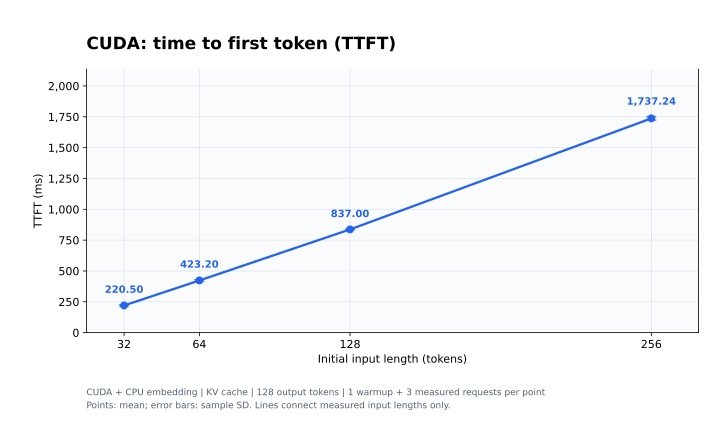
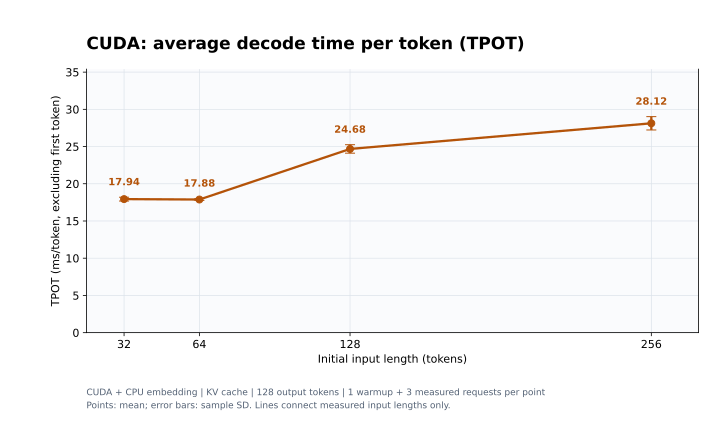
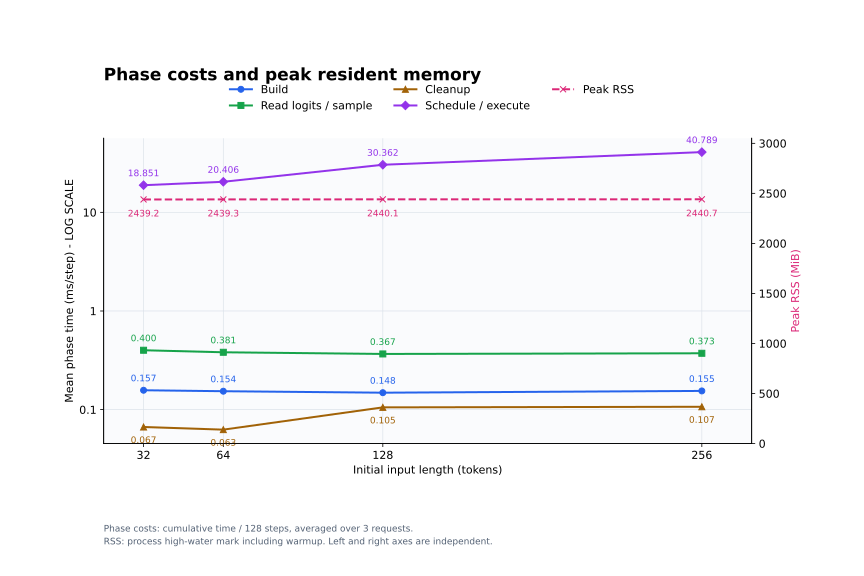
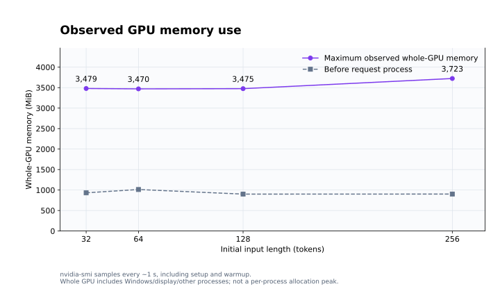

# Infer-LLM

仿照 llama.cpp 开发一个 C++ 推理框架，学习大模型如何进行推理。

| 日期 | 性能测试 | 报告与原始数据 |
|---|---|---|
| 2026-11-07 | CUDA 优先：连续 KV Cache（最新） | [查看报告](docs/performance/cuda-contiguous-kv-20261107/README.md) · [数据目录](docs/performance/cuda-contiguous-kv-20261107/) |
| 2026-11-04 | CPU：连续 KV Cache | [查看报告](docs/performance/cpu-contiguous-kv-20261104/README.md) · [数据目录](docs/performance/cpu-contiguous-kv-20261104/) |
| 2026-10-28 | CPU：无 KV Cache | [查看报告](docs/performance/cpu-no-kv-20261028/README.md) · [数据目录](docs/performance/cpu-no-kv-20261028/) |

## 最新测试：CUDA 优先、连续 KV Cache（2026-11-07）

RTX 4060 Laptop GPU，CUDA 12.6.85，驱动 581.42；CPU 为 i7-13620H，8 个 worker。WSL2 Ubuntu 20.04.3，Release 构建，Qwen3-0.6B-F32。

**CPU 负责 embedding，CUDA 优先执行其余计算，KV 常驻 GPU。** 四组输入为 32/64/128/256 token，每组固定生成 128 token，预热 1 次、正式 3 次。输入为合成 token，贪心采样，EOS 不提前停止。

### TTFT：首 token 延迟

TTFT 为 **220.50–1737.24 ms**，不包含模型加载和分词。

### TPOT：后续 token 平均耗时

| 输入 token | TTFT (ms，均值 ± 标准差) | TPOT (ms/token，均值 ± 标准差) | Decode (token/s) | 请求总耗时 (s) |
|---:|---:|---:|---:|---:|
| 32 | 220.50 ± 5.39 | 17.94 ± 0.26 | 55.753 | 2.499 |
| 64 | 423.20 ± 6.59 | 17.88 ± 0.13 | 55.922 | 2.694 |
| 128 | 837.00 ± 2.73 | 24.68 ± 0.57 | 40.534 | 3.971 |
| 256 | 1737.24 ± 14.04 | 28.12 ± 0.89 | 35.584 | 5.309 |

均值 ± 样本标准差；Decode 排除首 token。32、64 两组 TPOT 接近，128、256 两组增加。执行计时等待 GPU 完成，不是只测 kernel 提交时间。

### 资源与阶段耗时

| 输入 token | 建图 (ms/步) | 读取 logits/采样 (ms/步) | 清理 (ms/步) | 调度执行 (ms/步) | 峰值 RSS (MiB) |
|---:|---:|---:|---:|---:|---:|
| 32 | 0.157 | 0.400 | 0.067 | 18.851 | 2439.23 |
| 64 | 0.154 | 0.381 | 0.063 | 20.406 | 2439.34 |
| 128 | 0.148 | 0.367 | 0.105 | 30.362 | 2440.13 |
| 256 | 0.155 | 0.373 | 0.107 | 40.789 | 2440.67 |

阶段耗时是包含 Prefill 的平均 ms/步，左轴为对数刻度；RSS 为主机进程高水位，右轴为线性刻度，含加载和预热。

整卡显存观测最大值为 **3470–3723 MiB**，包含 Windows 显示等其他占用，**不是本进程精确峰值显存**。每秒采样可能漏掉瞬时峰值。

12 次正式请求全部成功，各组三次输出 checksum 一致；未触发内存或外部 CPU 干扰阈值。小规模 CPU/CUDA 生成对照一致，尚未进行完整 logits/逐算子误差验证。

[完整报告与统计口径](docs/performance/cuda-contiguous-kv-20261107/README.md) · [原始数据](docs/performance/cuda-contiguous-kv-20261107/) · [测试脚本](benchmarks/cuda/README.md)
