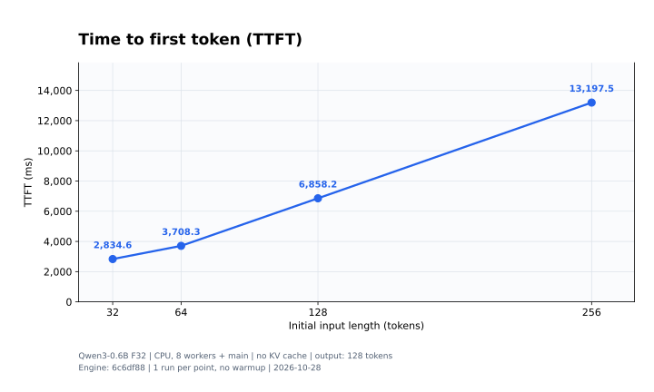
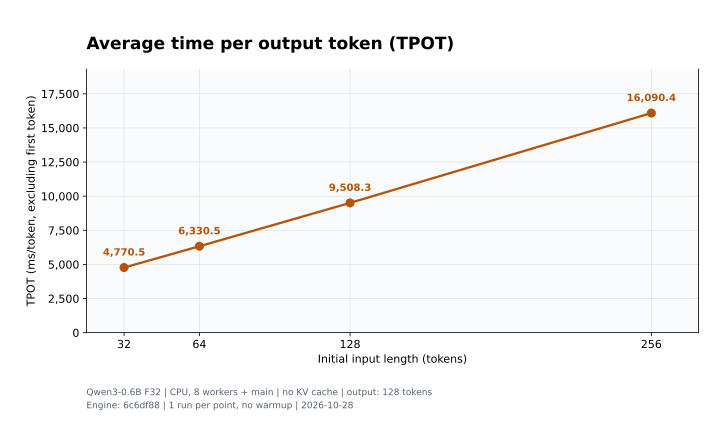
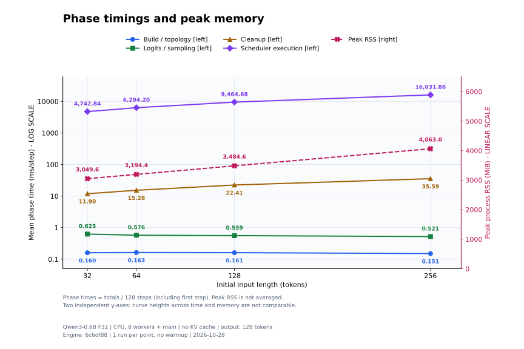

# Infer-LLM

仿照 llama.cpp 开发一个 C++ 推理框架，学习大模型如何进行推理。

## CPU 性能基线

本地单请求、Qwen3-0.6B F32、8 个 CPU 工作线程。**当前无 KV Cache**：每次生成都重算完整前缀，且计算所有输入位置的 logits。
以下 Decode 指标表示本实现的后续生成速度，不能直接当作具有 KV Cache 的单 token decode 性能。
四组固定生成 128 个 token，实际计算的前缀分别从32、64、128、256.
### 测试环境与版本

| 项目 | 配置 |
|---|---|
| 引擎 Git 提交 | `6c6df88dd556898e8deea78211ec94a639dec328` |
| CPU | 13th Gen Intel Core i7-13620H |
| 系统 | WSL2，Ubuntu 20.04.3 LTS，x86_64 |
| 内核 | `6.18.54.1-microsoft-standard-WSL2` |
| 可见资源 | 16 个逻辑 CPU；约 7.64 GiB RAM；2 GiB Swap |
| 工作线程 | 自动选择 8 个线程池 worker；主线程也参与算子计算；未绑核、未固定 CPU 频率 |
| 构建 | Release，GCC 13.1.0，`-O3 -DNDEBUG`；CPU-only |
| 模型 | `models/Qwen3-0.6B-F32.gguf`，F32，2,390,150,816 字节 |
| 输入 / 采样 | 固定合成 token `(100+i) % vocab_size`；贪心采样；遇 EOS 仍生成至指定数量 |
| 负载 | 单请求、各组独立进程、串行执行；每组 1 次正式测试|
| 计时工具 | 独立 C++ `inferllm-bench`，`std::chrono::steady_clock` |

本地 benchmark 不在该提交中（现有 `.gitignore` 忽略了
`benchmarks/`）。本报告保留工具源码指纹与原始结果，避免仅凭 Git 提交误认测试工具版本。

### 性能曲线

三张图的横轴均为**初始输入长度（token）**，按 32、64、128、256 的实际数值间距描点连线。
每个点仅有一次测量，连线用于观察趋势，不代表额外测过中间长度；图中标注的是实测数值。

#### TTFT：首 token 延迟

纵轴为 ms，使用线性刻度。

#### TPOT：后续 token 平均耗时

纵轴为 ms/token，使用线性刻度；排除首 token，按 127 个后续 token 计算。

#### 资源与阶段耗时：合并展示

同一张图叠加五条曲线：**蓝色圆点＝建图、绿色方块＝读取 logits/采样、棕色三角＝清理、
紫色菱形＝调度执行、粉色叉形虚线＝峰值 RSS**。

左纵轴为各阶段平均耗时 **ms/步（对数刻度）**，右纵轴为峰值内存 **MiB（线性刻度）**。
左右轴独立，不能根据曲线的高低直接比较耗时与内存。对数轴让相差数万倍的阶段耗时都能看清。

| 输入 token | 建图 (ms/步) | 读取 logits/采样 (ms/步) | 清理 (ms/步) | 调度执行 (ms/步) | 峰值 RSS (MiB) |
|---:|---:|---:|---:|---:|---:|
| 32 | 0.160 | 0.625 | 11.897 | 4742.835 | 3049.57 |
| 64 | 0.163 | 0.576 | 15.280 | 6294.196 | 3194.44 |
| 128 | 0.161 | 0.559 | 22.413 | 9464.685 | 3484.55 |
| 256 | 0.151 | 0.521 | 35.588 | 16031.876 | 4063.02 |
