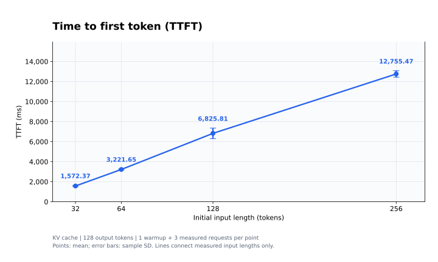
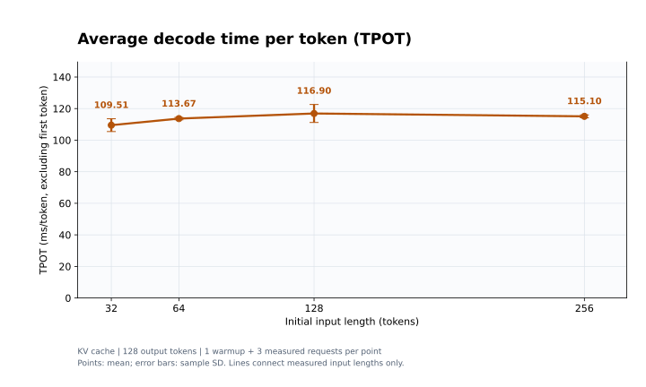
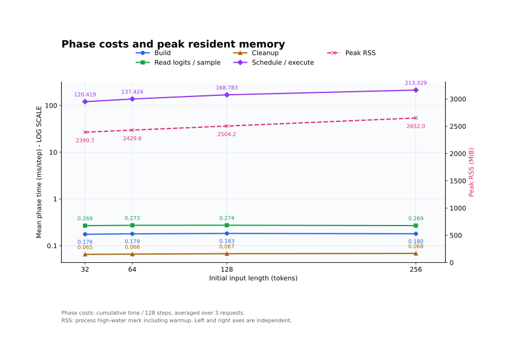

# CPU 性能测试：连续 KV Cache

四组初始输入长度为 **32、64、128、256 token**，均固定生成 **128 个 token**，遇到 EOS 也继续。
首轮 Prefill 处理完整输入，后续 127 步各处理一个新 token；每组先预热 1 次，再正式测量 3 次。
横轴按真实输入长度间距绘制，延迟点为均值、误差棒为样本标准差，连线不代表额外测过中间长度。

### TTFT：首 token 延迟

纵轴为 ms，线性刻度。从创建本轮 KV 序列开始计时，至首次采样完成；不含模型加载和分词。

输入从 32 增至 256（8 倍）时，TTFT 从 **1.572 s** 增至 **12.755 s**，约为 **8.11 倍**，这四个测点总体接近线性增长。

### TPOT：后续 token 平均耗时

纵轴为 ms/token，线性刻度。排除首 token，按后续 127 个 token 的采样间隔计算。

四组 TPOT 均值约为 **110–117 ms/token**，后续生成速度约 **8.57–9.14 token/s**。
在本次 32–256 的输入范围内，Decode 耗时变化远小于 Prefill；128 和 256 两点的误差范围重叠，不能据此认定更长上下文更快。

| 输入 token | TTFT (ms，均值 ± 标准差) | TPOT (ms/token，均值 ± 标准差) | Decode (token/s) | 请求总耗时 (s) |
|---:|---:|---:|---:|---:|
| 32 | 1572.37 ± 59.90 | 109.51 ± 4.06 | 9.140 | 15.480 |
| 64 | 3221.65 ± 49.05 | 113.67 ± 0.77 | 8.798 | 17.657 |
| 128 | 6825.81 ± 527.85 | 116.90 ± 5.70 | 8.568 | 21.672 |
| 256 | 12755.47 ± 320.92 | 115.10 ± 0.92 | 8.689 | 27.373 |

请求总耗时截至最后一次采样完成。Decode 速度取三次请求速度的算术均值，因此与平均 TPOT 的倒数可能略有差异。

### 资源与阶段耗时：合并展示

图中配色：**蓝色圆点＝建图、绿色方块＝读取 logits/采样、棕色三角＝清理、紫色菱形＝调度执行、粉色叉形虚线＝峰值 RSS**。

左轴为累计阶段耗时除以 128 步后、再对三次请求取均值的 **ms/步（对数刻度）**；右轴为该组进程的 **峰值 RSS（MiB，线性刻度）**。
两个纵轴独立，不能比较曲线高低来判断耗时与内存的大小。

| 输入 token | 建图 (ms/步) | 读取 logits/采样 (ms/步) | 清理 (ms/步) | 调度执行 (ms/步) | 峰值 RSS (MiB) |
|---:|---:|---:|---:|---:|---:|
| 32 | 0.176 | 0.269 | 0.065 | 120.419 | 2390.68 |
| 64 | 0.179 | 0.273 | 0.066 | 137.424 | 2429.62 |
| 128 | 0.183 | 0.274 | 0.067 | 168.783 | 2504.16 |
| 256 | 0.180 | 0.269 | 0.068 | 213.329 | 2651.95 |

调度执行仍占主要耗时；该阶段的“ms/步”包含第一步 Prefill，不能当作纯 Decode 的 TPOT。
峰值 RSS 从 **2390.68 MiB** 增至 **2651.95 MiB**，增加约 **261.27 MiB**。RSS 包含权重驻留页、RoPE 表、KV 和激活缓冲区，且包含预热高水位，不等于 KV 本身的大小。

本次清理阶段包含访问归还、提交和图销毁，Scheduler 跨步持有激活缓冲区；历史报告逐节点释放激活，不能将两次报告的全部差异归因于 KV Cache。

四组串行测量期间，可用内存最低为 **5290.55 MiB**；Swap 使用、换入/换出页数、内存 PSI 停顿均为 **0**。各组观测到的 benchmark 之外 CPU 平均占用为全机容量的 **1.07%–1.53%**，未触发资源干扰阈值。未观察到内存紧张或换页造成的性能污染；这些监测不代表已经完全隔离宿主机负载和 CPU 频率波动。

四组的实际输入计算量分别为 **159、191、255、383 token**（P + 127）；各组三次正式测试的输出 token 校验值一致。

原始结果：[32](p32.csv)、[64](p64.csv)、[128](p128.csv)、[256](p256.csv)；[资源监测汇总](system-summary.json)、[绘图脚本](plot_results.py)。

日志和源码指纹保留测试时的原始内容；日志中的旧输出路径对应本次重命名前的目录。

[返回测试索引](../../../README.md)
