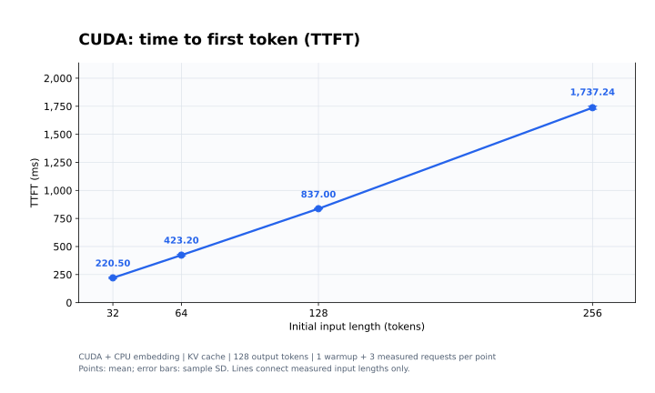
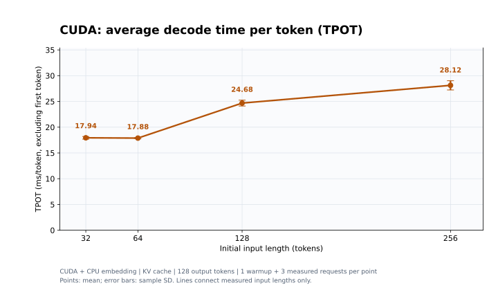
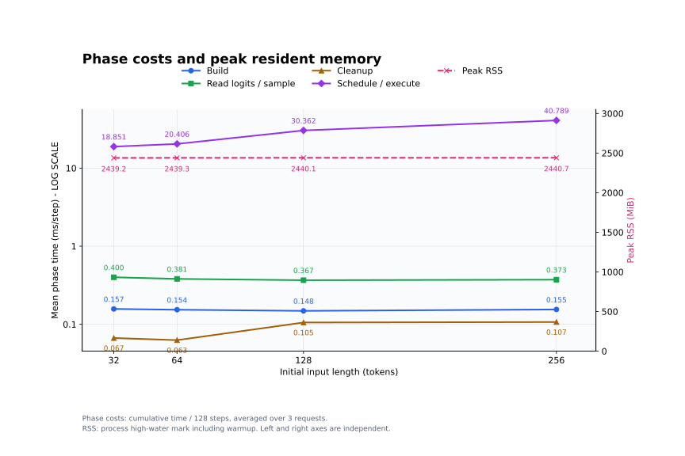
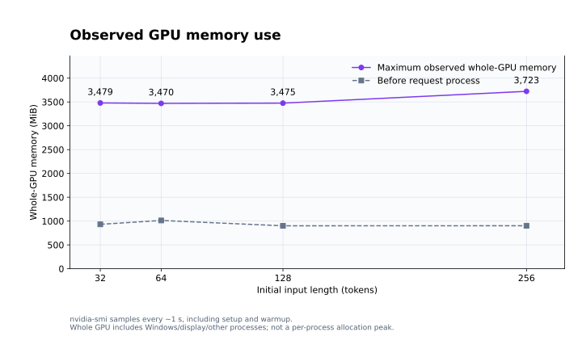

# CUDA 性能测试：GPU 优先、连续 KV Cache

测试日期：2026-11-07。CPU 保留 embedding；本报告不是全 GPU 推理。

四组输入为 **32、64、128、256 token**，均生成 **128 token**。首轮 Prefill，后续 127 步为单 token Decode。每组预热 1 次、正式 3 次；图表点为均值，误差棒为样本标准差，连线只连接实际测点。

## 测试环境与版本

| 项目 | 配置 |
|---|---|
| 测量时 HEAD | `9805e5d885ac6e07b9f2575c4581d632ddd42d1c`；实际源码以[源码指纹](source-hashes.json)为准 |
| CPU | 13th Gen Intel Core i7-13620H；8 个 worker，主线程也参与 |
| GPU | RTX 4060 Laptop GPU；8188 MiB；计算能力 8.9 |
| 驱动 / Toolkit | 581.42 / CUDA 12.6.85 |
| 系统 | WSL2，Ubuntu 20.04.3，内核 `6.18.54.1-microsoft-standard-WSL2` |
| 构建 | Release；GCC 13.1.0，C++23；NVCC C++20，`-O3 -DNDEBUG`，架构 89 |
| 模型 | Qwen3-0.6B-F32，2,390,150,816 字节；SHA256 见 [manifest](manifest.json) |
| 设备策略 | CUDA 优先，CPU embedding，KV cache 常驻 CUDA；输入和 θ 表由调度器复制 |
| 负载 | 单请求，四组独立进程串行；每组预热 1 次，正式 3 次，固定输出 128 token |
| 输入 / 采样 | 合成 token `(100+i)%vocab_size`，贪心采样，EOS 不提前停止 |

## TTFT：首 token 延迟



TTFT 从 **220.50 ms** 增至 **1737.24 ms**，输入增长 8 倍时延迟约增长 **7.88 倍**。从请求开始至首次采样完成，包含 KV 序列创建，不包含模型加载和分词。

## TPOT：后续 token 平均耗时



| 输入 token | TTFT (ms，均值 ± 标准差) | TPOT (ms/token，均值 ± 标准差) | Decode (token/s) | 请求总耗时 (s) |
|---:|---:|---:|---:|---:|
| 32 | 220.50 ± 5.39 | 17.94 ± 0.26 | 55.753 | 2.499 |
| 64 | 423.20 ± 6.59 | 17.88 ± 0.13 | 55.922 | 2.694 |
| 128 | 837.00 ± 2.73 | 24.68 ± 0.57 | 40.534 | 3.971 |
| 256 | 1737.24 ± 14.04 | 28.12 ± 0.89 | 35.584 | 5.309 |

后续 Decode 为 **35.58–55.92 token/s**。32、64 两组接近；128、256 两组明显增加，当前数据不足以单独归因于某个核函数或资源瓶颈。

## 资源与阶段耗时



| 输入 token | 建图 (ms/步) | 读取 logits/采样 (ms/步) | 清理 (ms/步) | 调度执行 (ms/步) | 峰值 RSS (MiB) |
|---:|---:|---:|---:|---:|---:|
| 32 | 0.157 | 0.400 | 0.067 | 18.851 | 2439.23 |
| 64 | 0.154 | 0.381 | 0.063 | 20.406 | 2439.34 |
| 128 | 0.148 | 0.367 | 0.105 | 30.362 | 2440.13 |
| 256 | 0.155 | 0.373 | 0.107 | 40.789 | 2440.67 |

左轴是阶段累计耗时除以 128 步后取均值的 **ms/步（对数刻度）**，右轴是主机进程 **峰值 RSS MiB（线性刻度）**。执行阶段包含 Prefill，不能将它的 ms/步当作 Decode TPOT。RSS 包含加载与预热的高水位和 mmap 驻留页，不包含独立显存统计。



| 输入 token | 测试前整卡显存 (MiB) | 整卡显存观测最大值 (MiB) | GPU 利用率最大值 (%) | 温度最大值 (°C) |
|---:|---:|---:|---:|---:|
| 32 | 932 | 3479 | 89 | 59 |
| 64 | 1013 | 3470 | 99 | 61 |
| 128 | 901 | 3475 | 98 | 62 |
| 256 | 902 | 3723 | 100 | 67 |

显存来自约每秒一次的 `nvidia-smi` 采样，覆盖加载、预热和正式测试，包含 Windows 显示及其他 GPU 用户；**不是本进程精确峰值显存**，也可能漏掉瞬时峰值。不要将 RSS 与整卡显存简单相加作为本进程内存占用。

四组最低可用主机内存为 **6023.71 MiB**，Swap 使用、换入/换出和内存 PSI 停顿均为 **0**。外部 CPU 平均占用为全机容量的 **1.09%–1.39%**，未触发脚本资源干扰阈值。记录到少量 I/O PSI 停顿，详见资源汇总。没有控制 GPU/CPU 频率，也不能排除 Windows 宿主负载；温度最高观测到 **67°C**。

## 计时与验证

- `prepare`：预留 KV、准备输入 token 和绝对位置。
- `build`：建图与拓扑排序。
- `execute`：调度、激活分配、跨设备复制、CPU/GPU 计算及 GPU 完成同步。不是纯 kernel 时间。
- `sample`：末尾 logits 传回 CPU 并贪心采样。
- `cleanup`：归还 KV 访问、提交有效长度、销毁图。
- `request` 截至最后采样完成；`wall` 还包含最后清理和序列释放。
- TPOT = `(最后采样时刻−首次采样时刻)/127`；Decode 速度按每轮算术平均，因此不必等于平均 TPOT 的倒数。

12 次正式请求全部成功，实际计算量分别为 **159、191、255、383 token**。各组三次 checksum 一致，绘图脚本校验计时公式、行数和计算量。六项 CLI 检查通过。

附加的 P=4、N=2 CPU/CUDA 试跑均成功，token checksum 均为 **39812**，见 [CPU CSV](smoke-cpu.csv)、[CUDA CSV](smoke-cuda.csv)。这是小规模生成结果对照，**没有完成逐算子误差或完整 CPU/CUDA logits 对比**，性能结果不等同于数值正确性证明。

正式测试前后源码 SHA256 一致。日志 `Engine git` 是构建配置时的 HEAD（`258e73cc39f1b2f58e18d46697ae0d809f42bbe8`），manifest 是启动矩阵时的 HEAD；构建配置与矩阵启动之间 HEAD 已更新，复现应结合源码指纹而不是仅用日志提交号。

## 复现与原始数据

```bash
python3 benchmarks/cuda/run_matrix.py --output docs/performance/新的测试目录
python3 docs/performance/cuda-contiguous-kv-20261107/plot_results.py
```

构建和参数见 [CUDA benchmark 使用说明](../../../benchmarks/cuda/README.md)。绘图需要 matplotlib；本次使用现有 d2l-zh 环境中的 matplotlib 3.7.2。

原始 CSV：[32](p32.csv) · [64](p64.csv) · [128](p128.csv) · [256](p256.csv)。

[测量汇总](summary.json) · [系统监测汇总](system-summary.json) · [测试环境](manifest.json) · [源码指纹](source-hashes.json) · [运行日志](matrix.log) · [绘图脚本](plot_results.py)。每组日志和每秒监测 CSV 保存在同目录。

[历史测试](../README.md) · [返回项目首页](../../../README.md)
